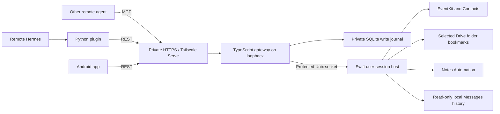

# iBridge

A personal bridge from an AI agent on another computer to your Mac's Calendar,
Reminders, Contacts, selected iCloud Drive folders, Notes, and local Messages
history. Runs on **macOS 14+**, with native **Apple silicon (arm64)** and Intel
builds.

Your Apple Account stays on the Mac. Remote clients use scoped tokens over private
HTTPS and can access only the operations and containers you authorize.

## Get started

Follow the [Mac setup guide](docs/macos-setup.md) to install the menu bar app and
gateway, grant local permissions, select folders, and create a client token.
From a checkout on your Mac, with Xcode Command Line Tools, Python 3.10+, and
Node.js 24+ installed:

```sh
scripts/install_macos.sh --dry-run
scripts/install_macos.sh
scripts/status_macos.sh
```

Then enable private HTTPS with Tailscale Serve using the guide. On the computer
running Hermes, [install and configure the plugin](plugins/hermes-ibridge/README.md):

```sh
python3 scripts/install_hermes_plugin.py
```

Set `IBRIDGE_URL` to the Mac's HTTPS origin and `IBRIDGE_TOKEN` to its scoped
client token in that Hermes profile's secret settings. Enable the plugin and
restart the profile. Begin with `ibridge_capabilities`, discover the authorized
calendar/list/root IDs, and try the guide's calendar → document → reminder workflow.

Other agents can use the [MCP endpoint](docs/mcp.md) at `/mcp` with a static Bearer
header. This personal MVP does not implement OAuth discovery or consent.

## What the MVP includes

| Component | Implemented behavior |
| --- | --- |
| Swift menu bar app | Local permission controls, status, selected-folder bookmarks, same-user private socket |
| Calendar | List authorized calendars, read time-bounded events, create simple timed events |
| Reminders | List authorized lists, read reminders, create and complete individual reminders |
| Contacts | Search contacts after local permission and client operation authorization |
| Drive | List/search selected roots, read small files, create-only uploads; 256 KiB file limit |
| Notes | Locally enabled Automation, exact folder grants, unlocked plain-text reads/search and new-note creation |
| Messages | Locally enabled, read-only history with Full Disk Access, exact conversation grants, bounded text search |
| REST and MCP gateway | Shared command layer, scoped hashed tokens, rotation/revocation, input validation |
| Durable writes | SQLite records before dispatch, saved receipts, restart-safe replay, blocked uncertain outcomes |
| Hermes plugin | 21 registered tools, current capability checks, bounded responses, sanitized errors |
| Android client | Android 8.0+ read-only client, encrypted connection storage, capability discovery, service browsing, and small Drive file export |
| Installation | User LaunchAgents, preserved state on upgrades, signed bundles, arm64 and Intel CI artifacts |

Notes and Messages are **off by default**. Enable each in the Mac app and grant
its folder or conversation IDs to a client. Existing tokens gain no new resource
access. See [adapter setup and limits](docs/notes-messages.md).

This MVP does not send messages, delete data, make bulk changes, create event
invitations, or support recurring event creation.

## Android app

The [native Android app](android/README.md) connects to the same v1 server with
client-specific tokens. It browses Calendar, Reminders, Contacts, selected Drive
folders, and locally enabled Notes and Messages with explicit resource grants.
Saved credentials use Android Keystore
encryption; small Drive files can be exported through the system file picker.

This first Android version is read-only. It does not sign in to iCloud directly
or synchronize into Android's system apps. Build and install instructions are in
[android/README.md](android/README.md). Client fixtures and emulator checks do not
replace live integration testing with your Mac.

## Architecture



REST and MCP use the same authorization and write journal. The host checks macOS
permissions and resource boundaries again. Remote requests cannot trigger local
permission prompts. Notes uses authorized Apple Events. The optional Messages
adapter reads the current user's local database through guarded, read-only SQLite
queries; it does not write conversation content or send messages. No Apple Account
credentials are sent to the remote agent.

Writes require a stable `request_id`. Replaying a completed request with the same
client identity, key, and arguments returns its saved receipt. Reusing the key
with different arguments fails. A crash or lost response can leave an uncertain
outcome; the journal retains it and prevents automatic re-execution. Inspect the
Mac and `scripts/ibridge.sh journal list` before deciding what to do next. The
Apple save and SQLite transaction cannot provide an exactly-once guarantee.

## Validation and limits

Automated checks cover the Python plugin and installers, real HTTP and Unix-socket
gateway integration, official MCP SDK clients, and native Swift code. GitHub
Actions builds and tests on Apple silicon and Intel, verifies the signed app,
and smoke-tests installation. The plugin is also checked with the official
[Hermes Plugin Doctor and catalog validator](docs/hermes-compatibility.md).

The cross-language workflow tests run the real plugin and gateway against a native
IPC fixture. Native Notes tests compile the automation script and inject a
transport; Messages tests use synthetic databases and bounded archived-body
fixtures. macOS CI has no Apple Account. **Live permissions, your selected
folders, Tailscale connectivity, and iCloud synchronization still require the
[acceptance checks on your Mac](docs/macos-setup.md#verify-the-complete-workflow).**

A saved result means saved on this Mac. `meta.sync_state: "local"` never confirms
that iCloud delivered it to another device. The Mac must be awake, reachable, and
logged in; login agents do not run before login after reboot. Cloud-only files
may need downloading. Personal app builds are ad-hoc signed, not notarized, and
rebuilding may require granting permissions again. Keep System Integrity
Protection and certificate verification enabled.

## Development

Use Node.js 24+ and Python 3.10+. From the repository root:

```sh
npm ci --prefix gateway
npm run check --prefix gateway
npm run build --prefix gateway
npm test --prefix gateway
python3 -m pip install -r scripts/requirements-compatibility.txt
IBRIDGE_REQUIRE_GATEWAY_TESTS=1 python3 -m unittest discover -s tests -v
python3 scripts/export_operations.py --check
```

On macOS, also run:

```sh
swift test --package-path macos
scripts/build_macos_app.sh --arch arm64 --output build/arm64
```

Tests bind local HTTP and Unix sockets. The gateway must be built before the
cross-language tests; CI requires them instead of allowing them to skip. The
shared operation catalog is generated from the Hermes schemas and checked for
drift against the native bundled copy.

Completed features are committed and pushed independently, merged into `main`
after relevant validation, and reflected in this README.

## Project documents

- [Development status and production-readiness backlog](Development.md)
- [Mac installation, private HTTPS, and live acceptance](docs/macos-setup.md)
- [Notes and Messages setup, resource grants, and limits](docs/notes-messages.md)
- [Android client](android/README.md)
- [Hermes plugin](plugins/hermes-ibridge/README.md)
- [MCP transport and client configuration](docs/mcp.md)
- [Gateway administration](gateway/README.md)
- [HTTP contract](docs/bridge-api.md) and [native IPC protocol](docs/native-protocol.md)
- [Roadmap](docs/roadmap.md) and [Hermes compatibility](docs/hermes-compatibility.md)
