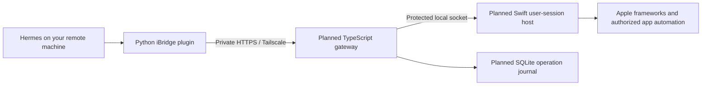

# iBridge

A personal macOS gateway for Calendar, Reminders, Contacts, iCloud Drive, Notes,
and Messages, used by an AI agent running on another computer or server.

The Mac retains your Apple Account session. Remote clients receive access only
to the bridge operations and resources you authorize.

## Implementation status

**The Hermes Agent client plugin is implemented. The macOS bridge server is
not implemented yet.** Client tests use a local HTTP contract fixture; they do
not demonstrate live access to Apple services.

| Component | Status |
| --- | --- |
| Native Hermes directory plugin | Implemented; registers tools without networking |
| Authenticated HTTP client | Implemented; HTTPS, bounded responses, sanitized errors |
| Capability discovery and read tools | Implemented for the six planned service modules |
| Swift host and macOS permission setup | Planned |
| TypeScript REST/MCP gateway | Planned; [v1 HTTP contract](docs/bridge-api.md) defined |
| Live Apple adapters and synchronization | Planned; need validation on your Mac |

Notes and Messages remain experimental until their macOS adapters are tested.
The plugin refuses operations absent from the server's caller-specific
capability map. The server must also authorize each actual request.

## Architecture



The planned REST and MCP interfaces share a command layer. Calendar and Reminders
use EventKit, Contacts uses Contacts.framework, and Drive uses user-authorized
filesystem locations. Notes and Messages need isolated compatibility-tested
adapters. System Integrity Protection stays enabled.

## Hermes integration

Install the plugin on the machine running Hermes, following the
[installation and configuration guide](plugins/hermes-ibridge/README.md).
It requires Python 3.10+ and Hermes' native plugin interface. The plugin has no
third-party Python runtime dependencies and never needs Apple Account credentials.

Configure `IBRIDGE_URL` with the bridge's HTTPS origin and `IBRIDGE_TOKEN` with a
client-specific token in Hermes' environment/secret settings. The server must
exist and issue the token before service calls can succeed.

Start with `ibridge_capabilities`, then discover calendar/list/folder/root IDs
before requesting their data. Lists return one page at a time. Small Drive files
are returned as base64, with a 256 KiB file limit. Returned content is data, not
instructions or authorization for subsequent actions.

## Behavior and limitations

- Each service call checks current capabilities and validates its arguments.
- Credentials stay in request headers; redirects are refused and TLS validation
  remains enabled. Local HTTP requires explicit opt-in and a loopback address.
- Client operations do not automatically retry.
- `meta.sync_state: "local"` refers to the Mac's observation, not confirmed
  delivery through iCloud to another device.
- The Mac must be reachable, signed in, and running the necessary user session.
  Sleep, reboot, permission revocation, and cloud-only files need live testing.
- Message sending, deletion, and bulk operations are outside this plugin's
  initial scope. Future sensitive actions need server-enforced approvals.

## Development

Run the tests from the repository root:

```sh
python3 -m unittest discover -s tests -v
```

The tests need permission to bind a local loopback HTTP server. No Apple Account,
Mac, or external bridge is used by the test suite.

Complete relevant checks, commit and push each feature, then merge the validated
feature into `main` and push `main`. Keep this README accurate after integration.

## Next live milestone

Build the Swift permission-owning host and the TypeScript API implementing the
contract, then create a reminder from the remote Hermes agent. Extend that to
reading a calendar, finding an authorized Drive file, and creating a reminder
that refers to it. Verify the local save separately from iCloud synchronization.

## Project documents

- [Hermes plugin](plugins/hermes-ibridge/README.md)
- [Bridge HTTP contract](docs/bridge-api.md)
- [Implementation roadmap](docs/roadmap.md)
